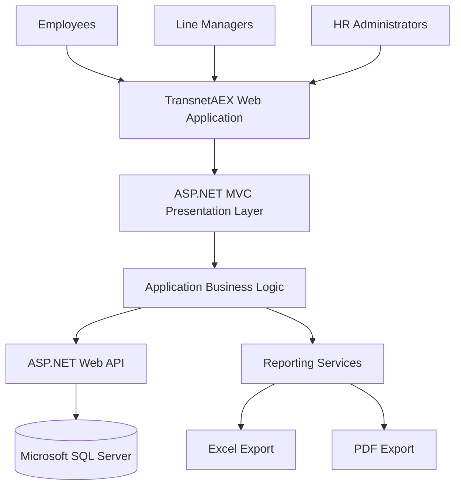

# TransnetAEX – Employee Exit Interview Management System

> A web-based Employee Exit Interview Management System designed to streamline, digitise, and centralise the employee exit interview process through a structured and secure workflow.

[](https://github.com/SimphiweT/TransnetAEX)
[](https://github.com/SimphiweT/TransnetAEX)
[](https://github.com/SimphiweT/TransnetAEX)
[](https://github.com/SimphiweT/TransnetAEX)

---

## Overview

**TransnetAEX** is an Employee Exit Interview Management System developed to modernise and improve the management of employee exit interviews within an organisational environment.

The system aims to replace manual and fragmented exit interview processes with a centralised digital platform that enables employees to complete exit interviews electronically while allowing line managers and Human Resources (HR) personnel to manage, monitor, and analyse the information collected.

The application provides a structured workflow connecting employees, line managers, and HR administrators, improving information accessibility, administrative efficiency, and the overall management of employee exit information.

## Key Objectives

- Digitise and streamline the employee exit interview process.
- Provide a centralised platform for managing employee exit information.
- Improve communication between employees, line managers, and HR.
- Reduce manual administrative processes and paperwork.
- Enable HR personnel to access and manage exit interview records.
- Generate reports for organisational analysis and decision-making.
- Improve the accessibility and organisation of employee exit information.

## Core Features

### 1. HR Administration

A dedicated HR management interface designed to provide authorised HR personnel with centralised access to the system.

Key capabilities:
- Secure HR authentication.
- Centralised management of exit interview records.
- Access to submitted employee exit interviews.
- Monitoring of exit interview submissions.
- Report generation and data export.

### 2. Employee Exit Interviews

A digital workflow that allows employees to complete their exit interview information electronically.

Key capabilities:
- Structured employee exit interview forms.
- Electronic submission of exit interview information.
- Simplified access to the exit interview process.
- Centralised storage of submitted information.

### 3. Line Manager Workflow

A dedicated workflow supporting line manager participation in the employee exit process.

Key capabilities:
- Access to relevant employee exit interview workflows.
- Structured participation in the exit interview process.
- Improved coordination between employees, management, and HR.

### 4. Reporting and Data Export

The system incorporates reporting capabilities to assist HR personnel with retrieving and analysing exit interview information.

Key capabilities:
- Excel report generation.
- PDF report generation.
- Structured access to employee exit information.
- Improved reporting and record management.

## Technology Stack

The project uses Microsoft technologies to support application development, business logic, data management, and reporting.

| Technology | Purpose |
|---|---|
| C# | Application and business logic |
| ASP.NET MVC | Web application architecture |
| ASP.NET Web API | Backend API functionality |
| Microsoft SQL Server | Relational database management |
| HTML5 | Web page structure |
| CSS3 | Application styling |
| JavaScript | Client-side functionality |
| Bootstrap | Responsive user interface |
| Visual Studio | Development environment |

*Note: The technology list reflects the intended project architecture. Individual components should be verified against the current source code.*

## System Architecture

The application follows a layered web application architecture.



### Architectural Components

- **Presentation Layer:** Provides the user interface and interaction with the system.
- **Business Logic Layer:** Handles application workflows and business rules.
- **API Layer:** Supports communication between application components.
- **Database Layer:** Stores and manages application information.
- **Reporting Layer:** Supports the generation of downloadable reports.

## Getting Started

### Prerequisites

Before setting up the project, ensure that the following development tools are available:

- Microsoft Visual Studio 2022 or a compatible version.
- .NET SDK compatible with the project.
- Microsoft SQL Server.
- SQL Server Management Studio (SSMS).
- Git.

### Installation

**1. Clone the repository**

```bash
git clone https://github.com/SimphiweT/TransnetAEX.git
```

**2. Navigate to the project directory**

```bash
cd TransnetAEX
```

**3. Open the solution**

Open the project solution (`.sln`) in Microsoft Visual Studio, if available.

**4. Configure the database**

Configure the SQL Server connection string in the application's configuration file.

Example:

```json
{
  "ConnectionStrings": {
    "DefaultConnection": "Server=YOUR_SERVER;Database=TransnetAEX;Trusted_Connection=True;TrustServerCertificate=True;"
  }
}
```

Replace the example server and database values with the appropriate development environment configuration.

**5. Restore dependencies and build**

Restore the NuGet packages and build the solution using Visual Studio.

**6. Run the application**

Configure the appropriate startup project and launch the application using Visual Studio.

*Note: The exact startup configuration, database scripts, migration procedure, and runtime commands depend on the current solution structure.*

## Security Considerations

Because the system deals with employee-related information, security and data protection are important considerations.

Recommended security practices include:

- Authentication and authorisation for restricted system functionality.
- Role-based access control.
- Secure database connection management.
- Server-side validation of submitted information.
- Protection of sensitive employee information.
- Secure handling of application configuration and credentials.
- Appropriate logging and error handling.

## Potential Future Enhancements

The following enhancements can support the continued development of the platform:

- Dashboard with exit interview analytics.
- Advanced reporting and filtering.
- Improved role-based access management.
- Email notifications and automated reminders.
- Enhanced audit trails.
- Data visualisation for HR reporting.
- Improved application security and validation.
- Deployment within an approved organisational hosting environment.

## Project Structure

The project is intended to follow a modular structure separating presentation, application logic, API functionality, and data access.

The exact directory structure should be documented once the current solution files and project folders are available.

## Contributing

Contributions and improvements are welcome.

For proposed changes:

1. Fork the repository.
2. Create a feature branch.
3. Implement and test your changes.
4. Submit a pull request describing the changes.

All contributions should maintain the project's architectural consistency, security considerations, and coding standards.

## Data Protection Notice

This project is intended for development and demonstration purposes.

No real employee records, confidential organisational information, production credentials, or sensitive Transnet data should be committed to this repository.

Any deployment involving actual organisational information must comply with applicable organisational policies and data protection requirements, including POPIA where applicable.

## License

No open-source licence has currently been specified for this repository.

Unless a licence is added by the repository owner, all rights remain reserved by the respective copyright holder.

## Project Information

**Project Name:** TransnetAEX – Employee Exit Interview Management System

**Repository:** [SimphiweT/TransnetAEX](https://github.com/SimphiweT/TransnetAEX)

**Developer:** Simphiwe Terrence Nxumalo

**Organisation / Project Context:** Transnet

---

*TransnetAEX – Streamlining Employee Exit Management Through Digital Transformation.*
